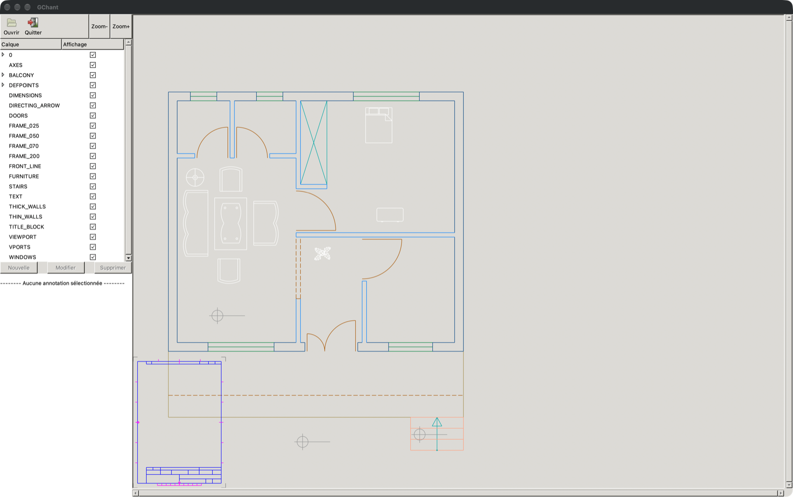
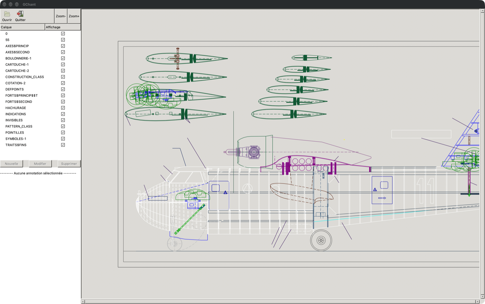

# 👷 GChant

A viewer for building-site plans, written in C++ with GTK 2 ([gtkmm](https://gtkmm.org)) and
[dxflib](https://qcad.org/en/90-dxflib). A site manager opens a plan drawn by the architect in a CAD
program (a DXF file), shows or hides its layers, zooms in, and reads the notes left on each layer.
Student project, 2010. The interface is in French.



## What it does

- **Ouvrir** opens a `.dxf` plan and draws it
- The **Calque** list shows every layer of the plan; untick **Affichage** to hide one
- **Zoom+** and **Zoom-**
- Notes for each layer appear under it in the list. They live in a `.ann` file next to the plan, with
  the same name (`2d_house_plan.DXF` → `2d_house_plan.ann`)

The **Nouvelle**, **Modifier** and **Supprimer** buttons for notes were never finished, and the
measuring tool from the original spec (`docs/cahier-des-charges.txt`) was never built.

## Sample plans

The `samples/` folder has a few plans to try, among them `2d_house_plan.DXF` (with notes),
`hexhouse.DXF`, `HAWKER.DXF`, `canadair.dxf` and `MINIHELI.dxf`. The Mac app carries them too, in
`GChant.app/Contents/Resources/samples`.



## Run it

### On a Mac

Download [**GChant-macOS.zip**](https://github.com/ValentinMumble/gchant/releases/latest/download/GChant-macOS.zip)
from the [latest release](https://github.com/ValentinMumble/gchant/releases/latest), unzip it, and move
**GChant.app** to your Applications folder. GTK is bundled inside, so there is nothing else to install.

The app is not signed. If macOS blocks it the first time, right-click it in Finder and choose **Open**.

### On Linux

Needs gtkmm 2.4 (`libgtkmm-2.4-dev` on Debian and Ubuntu):

```bash
make
./GChant
```

Start it from this folder: it reads `icon.gif` and writes `gchant.log` in the folder it starts in.

## Build it

### The Mac app

Needs gtkmm 2.4, pkg-config and dylibbundler:

```bash
brew install gtkmm pkgconf dylibbundler
```

Build `GChant.app` (about 32 MB, with its GTK libraries) and its zip `build/GChant-macOS.zip`:

```bash
./build-mac-app.sh
```

To publish a new version, attach the zip to a new GitHub release:

```bash
gh release create v1.1.0 build/GChant-macOS.zip --title "GChant 1.1.0"
```

Homebrew stops offering GTK 2 on 28 August 2027. The released app keeps working after that, since it
carries its own copy, but building it again will then need GTK 2 from somewhere else.

### Without the app

```bash
make
./GChant
```

Give it a plan to open it straight away: `./GChant samples/2d_house_plan.DXF`.

## Dev tools

`tools/screenshot.sh` opens the app on a plan and saves its window as a PNG, 1600 px wide (this is how
the screenshots in `docs/` were made). Build with `make` first.

```bash
tools/screenshot.sh samples/2d_house_plan.DXF docs/house.png
```

## License

GPL 2.0, like [dxflib](https://qcad.org/en/90-dxflib), which is included in `src/dxflib/`.
